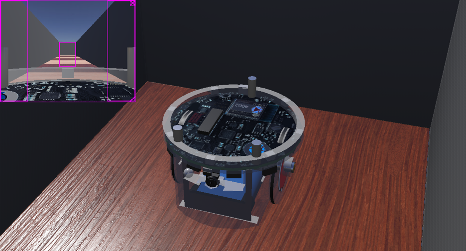

<p align="center">
  <a href="" rel="noopener">
 </a>
</p>

<h3 align="center">Evaluating the Robotic Control Reasoning Potential of Locally-Hosted LLMs</h3>

---

<p align="center"> Can a robot integrated with a locally-hosted large language model (LLM) <br> navigate a maze using only sensor data and a list of navigational rules to follow?
    <br> 
</p>

## Table of Contents
- [About](#about)
- [Getting Started](#getting_started)
- [Built Using](#built_using)
- [Authors](#authors)
- [Acknowledgments](#acknowledgement)

## About <a name = "about"></a>
Several existing studies have examined the capabilities of cloud-hosted Large Language Models (LLMs) in the field of robotics; however, integrating robotics with LLMs hosted on local machines is a field that has been sparsely explored. In this study, we aim to understand how locally hosted LLMs can be utilized within the reasoning section of robotic control by creating a kinematic-semantic evaluation framework that separates the complexity of fine-grained technical controls from high-level human language controls. This framework involves connecting two open source services, Webots for its deterministic physics simulation environments and Ollama for its API access to local LLMs, with a Python-based supervisor controller. The results showed that among the five selected local LLMs, the Qwen2.5:3b and Qwen2.5:7b models demonstrated the highest robotic control reasoning potential due to their scores in accuracy, efficiency, and latency tests. Further study of the use of LLMs in edge devices may prove it to be an alternative to cloud-hosted LLMs, especially in industries that handle confidential data, in areas that do not guarantee stable internet connectivity, and for individuals looking to reduce their operational costs.

## Getting Started <a name = "getting_started"></a>
These instructions will get you a copy of the project up and running on your local machine for development and testing purposes.

### Prerequisites
What things you need to install the software and how to install them.


#### Webots
- [Download](https://cyberbotics.com/#download)
- [System Requirements](https://cyberbotics.com/doc/guide/system-requirements)

#### Ollama
- [Download](https://ollama.com/download)

Models Tested:
- [Qwen2.5](https://ollama.com/library/qwen2.5)
- [LFM2.5](https://ollama.com/library/lfm2.5)
- [Gemma4](https://ollama.com/library/gemma4)

#### Python - 3.14+
- [Download](https://www.python.org/downloads/)

#### IDE of Choice

### Installing
A step by step series of examples that tell you how to get a development env running.

Step 1. Open Webots World Environment 

```
1. Open Webots
2. File > Open World
3. Select Webots World Environment under webots\mazes (.wbt files only)
```

Step 2. Create New Controller

```
In Webots,
1. File > New > New Robot Controller
2. In Webots Controller Wizard: Next > Select Python as the language > Name Controller > Finish
3. Open newly created controller in an IDE of your choice. Do not delete any automatically generated files.
```

Step 3. Upload Controller
```
1. Move all files under webots\controllers\main into newly created controller folder.
2. Move the code in main.py into the Python file that matches your controller folder name.
3. Delete main.py from the controller folder
```

Step 4. Customize Parameters
```
1. main.py calls run.py and accepts two paramters:
  a. collect_data: Boolean - True enables data collection
    i. Collected data is sent to a CSV file, found in run.py
  b. runNum: Int - Number of times the program will run, where finding the goal, timing out, or getting stuck denotes one run.
```

Step 5. Run
```
In Webots,
1. Select the Reset Simulation button to reload the controller folder and restart the simulation.
2. Press Play/Pause button to start or stop the simulation at your leisure. 
```

## Research <a name="research"></a>
If you are interested in learning more about how the system works, ["Evaluating the robotic control reasoning potential of locally-hosted LLMs"](research_paper.pdf) explains the framework, the data, and the results of testing the navigational capabilities of 5 locally-hosted LLMs .

## Built Using <a name = "built_using"></a>
- [Webots](https://cyberbotics.com/) -  Physics-based Simulation Software
- [Ollama](https://ollama.com/) - API Access to Local LLMs
- [Python](https://www.python.org/) - Supervisor Controller

## Authors <a name = "authors"></a>
- [@leberavery](https://github.com/leberavery) - Supervisor controller developer, Webots environment editor, LLM prompt engineer, and author of ["Evaluating the robotic control reasoning potential of locally-hosted LLMs"](research_paper.pdf)

## Acknowledgements <a name = "acknowledgement"></a>
- [linhbngo](https://github.com/linhbngo) - Associate Professor at West Chester University of Pennsylvania, Department of Computer Science
- [kmatotek](https://github.com/kmatotek) - West Chester University of Pennsylvania Alumni 
